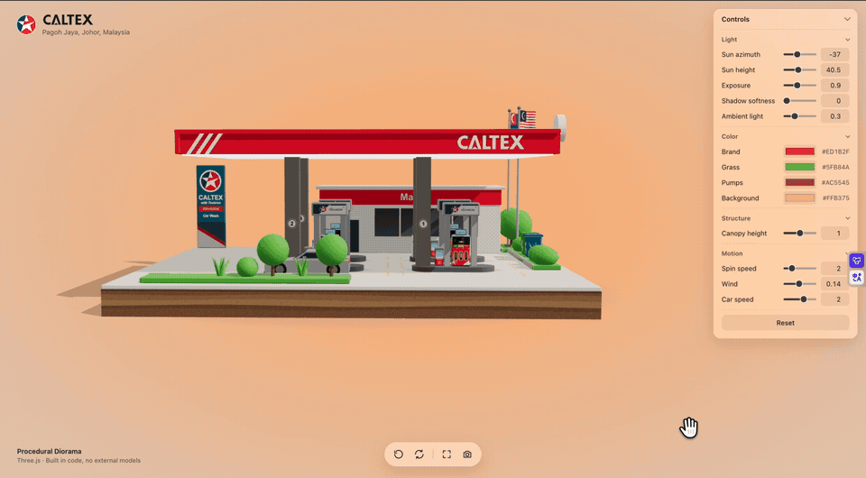

[English](../README.md) | [繁體中文](README.zh-TW.md)

# Petrol Station (Procedural Three.js Diorama)

馬來西亞柔佛 (Johor, Malaysia) Caltex 加油站的 3D Diorama，完全透過 Three.js 程式碼生成幾何模型、車輛動畫與 Canvas 2D / SVG 貼圖，無外部 3D 模型檔。

線上展示：https://shyinlim.github.io/petrol-img2threejs/



## 快速啟動

```bash
npm install
npm run dev
```

啟動後開啟瀏覽器前往 `http://localhost:5173`。

常用指令：
- `npm run dev`：啟動 Vite 開發伺服器 (`http://localhost:5173`)
- `npm run build`：打包正式版本到 `dist/`
- `npm run preview`：預覽打包後的 `dist/` 靜態頁面
- `npm run typecheck`：執行 `tsc --noEmit` 檢查 TypeScript 型別

## 網址參數模式

- `/` (Normal mode)：完整互動展示模式，含柔和陰影、環境光、飄動旗幟、進站跑車動畫、右側控制面板與底部工具列。
- `/?gate=1` (Gate mode)：自動化驗收專用模式，固定為 1024×687 參考視角、灰底無 UI、關閉陰影與旗幟動畫，確保截圖與像素比對穩定。
- `/?clay=1` (Clay mode)：全灰白模檢視模式，方便檢查模型輪廓與比例。

## 程式碼架構 (`src/`)

```
src/
├── src/main.ts                    # 應用程式入口：組裝 scene、model、car、UI 與 render loop
├── src/scene.ts                   # WebGLRenderer、PerspectiveCamera、OrbitControls 與太陽/環境光設定
├── src/textures.ts                # 所有 Canvas 2D 動態貼圖 (招牌、車格線、土壤分層、玻璃、斜紋) 與 SVG 貼圖
├── src/customizeModel.ts          # 模型後處理：圓角倒角、3D CALTEX 立體字、材質覆寫、draw call 合併與旗幟飄動
├── src/ui.ts                      # 右側控制面板滑桿/選色器、Raycaster 零件點選抬升、底部工具列
├── src/car.ts                     # 程序化生成的銀色雙門跑車與進站加油循環動畫
└── src/createCaltexStationModel.ts  # 由 object-sculpt-spec.json 自動生成的 157 個組件工廠 (勿手改)
```

### 重要全域掛載 (`window`)

供 Playwright 自動化驗收腳本呼叫：
- `window.__IMG2THREEJS_VIEWER__`：`{ renderer, scene, camera, controls }`
- `window.__IMG2THREEJS_CAPTURE__`：`{ setCamera, setReferenceMode }`
- `window.__IMG2THREEJS_PICK__`：`{ select, partCount }`
- `window.__IMG2THREEJS_READY__`：場景與 3D 字型載入完成後設為 `true`
- `window.__CAR_T__`：可選的時間覆寫值，用於截圖時凍結車輛位置

## 模型規格與重新生成

`src/createCaltexStationModel.ts` 是由規格檔 `object-sculpt-spec.json` 自動生成的，請勿直接手改。若要調整模型尺寸、顏色或零件配置：
1. 編輯 `scripts/build_spec_v11.py` 並執行 `python3 scripts/build_spec_v11.py` 更新 `object-sculpt-spec.json`。
2. 執行 generator 重新產出 `src/createCaltexStationModel.ts` 並更新 `parts.json` (`python3 scripts/dump_parts.py`)。
3. 本專案的 `vite.config.ts` 將 `publicDir` 指向 `material-evidence/`，載入貼圖與 `decals/` 資源皆依賴此路徑。
4. 歷史製作過程檔 (截圖、crops、舊版備份) 已收納於 `archive/`。

## 自動化測試與驗證 (`scripts/`)

執行前請確保已安裝 Python 3 與 Playwright (`playwright`、`Pillow`)：

```bash
python3 scripts/check_refactor.py       # 檢查 src/ 模組拆分、行數上限、npm scripts 與 README
python3 scripts/check_ui.py             # 檢查一般模式與 ?gate=1 下的 UI 互動、對比度與無報錯
python3 scripts/check_v11.py --task 3   # 檢查鏡頭構圖、旗幟飄動、雨棚底面、土壤分層與紅雨棚細節
```

其他幾何與材質檢查腳本位於 `scripts/` (`check_details.py`、`check_orbit.py`、`check_layout.py`、`check_canopy.py`、`check_scene.py`、`check_soil.py`、`check_hue.py`、`check_view.py`、`check_final.py`、`check_grounded.py`、`color_check.py`)。
